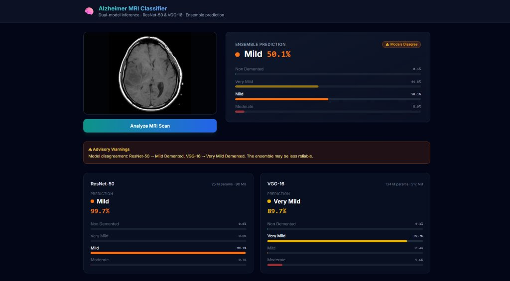
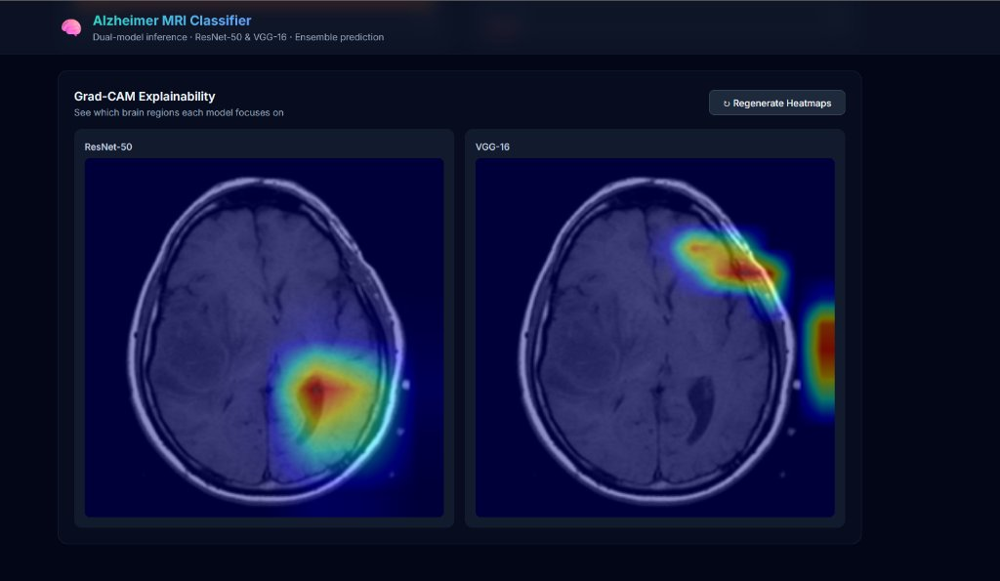
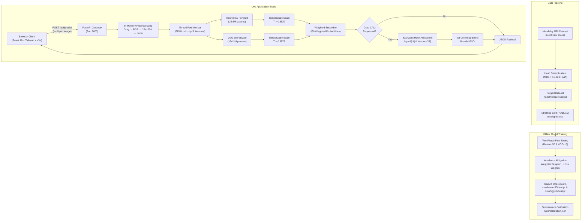

# 🧠 Alzheimer's Disease Stage Classification & Explainable AI (XAI) Platform

<div align="center">

[](https://www.python.org/)
[](https://pytorch.org/)
[](https://fastapi.tiangolo.com/)
[](https://react.dev/)
[](https://vitejs.dev/)
[](https://tailwindcss.com/)
[](https://developer.nvidia.com/cuda-zone)
[](https://data.mendeley.com/datasets/3r8hw8wmmk/1)
[](https://github.com/afrojkhan6033)
[](LICENSE)

<p align="center">
  <strong>An end-to-end medical computer vision platform featuring custom-trained ResNet-50 and VGG-16 architectures, temperature-calibrated ensemble inference, Grad-CAM visual interpretability, and a modern reactive clinical web application.</strong>
</p>

[Key Features](#-key-features) • [Application Preview](#-application-showcase) • [System Architecture](#-system-architecture) • [Models & Training](#-model-architecture--training-pipeline) • [Dataset & Preprocessing](#-dataset--preprocessing-pipeline) • [Getting Started](#-installation--quick-start) • [Author](#-developer--author)

</div>

---

## 📌 Executive Summary

Alzheimer's Disease (AD) is the primary cause of dementia globally, characterized by irreversible cognitive deterioration, hippocampal atrophy, and ventricular enlargement. Detecting the disease in early prodromal phases—such as **Very Mild Cognitive Impairment**—is paramount for clinical trials and early intervention strategies, but remains fraught with inter-observer variability in routine MRI inspections.

This repository provides an open-source, reproducible deep learning system developed to classify structural brain MRI scans across four distinct stages:
1. **Non-Demented** (Cognitively normal control)
2. **Very Mild Demented** (Early mild cognitive impairment)
3. **Mild Demented** (Established moderate cerebral atrophy)
4. **Moderate Demented** (Severe neurodegeneration)

Both **ResNet-50** and **VGG-16** models were trained and fine-tuned from scratch for this task by **Afroj Khan**, coupled with post-hoc **temperature scaling**, **weighted ensemble fusion**, automated **model agreement analysis**, and **Grad-CAM (Gradient-weighted Class Activation Mapping)** for transparent explainability in clinical research.

---

## 🖥️ Application Showcase

The accompanying web interface provides an interactive, low-latency environment for neuroimaging researchers to upload MRI slices, inspect multi-model probabilistic predictions, monitor agreement between architectures, and visualize neurological attention heatmaps.

### 1. Dual-Model Clinical Dashboard & Ensemble Inference
Upload any structural MRI scan via drag-and-drop. The FastAPI backend processes the slice through both neural networks simultaneously behind a GPU thread lock, computing temperature-calibrated probabilities, ensemble consensus, and automatic disagreement warnings.

<div align="center">
  
</div>

<br />

### 2. Grad-CAM Visual Explainability (XAI)
To eliminate "black-box" decisions, on-demand Grad-CAM computes activation gradients with respect to the final convolutional layers (`layer4[-1]` in ResNet-50 and `features[28]` in VGG-16), overlaying jet-colormap heatmaps onto the anatomical slice to reveal the exact brain regions influencing classification.

<div align="center">
  
</div>

---

## ⚡ Key Features

* **Custom-Trained Deep Neural Networks**: ResNet-50 (25.6M parameters) and VGG-16 (134.3M parameters) fine-tuned specifically on deduplicated brain MRI scans using two-phase transfer learning.
* **Temperature-Calibrated Probabilities**: Overconfident raw network logits are calibrated using post-hoc Platt temperature scaling ($T_{\text{ResNet}} = 0.3922$, $T_{\text{VGG}} = 0.3575$), minimizing Expected Calibration Error (ECE).
* **Weighted Ensemble & Agreement Analysis**: Automated consensus scoring weighted by validation macro-F1 ($w_{\text{ResNet}} = 0.9937$, $w_{\text{VGG}} = 0.9910$), with dynamic advisory badges if the models diverge.
* **Grad-CAM Explainability (XAI)**: Generates localized heatmaps directly using PyTorch forward/backward hooks without bulky external libraries, showing hippocampal and ventricular focal points.
* **Rigorous Data Deduplication**: Utilizes perceptual difference hashing (`dhash`, 16-bit) and cryptographic MD5 hashing to purge conflicting labels and duplicate scans across patient splits.
* **Uncertainty Quantification**: Calculates Shannon entropy ($H(p)$) across the predictive distribution to flag Out-Of-Distribution (OOD) images or ambiguous slices.
* **Privacy-Preserving In-Memory Inference**: Scans are validated, preprocessed, and evaluated entirely in RAM—no patient imaging data is persisted to disk or external servers.
* **Production-Grade Full Stack**: High-performance asynchronous FastAPI REST backend paired with a reactive React 18 (Vite + Tailwind CSS) client interface.

---

## 🔬 System Architecture

The following diagram illustrates the complete pipeline from raw dataset ingestion and transfer learning to live multi-threaded inference and explainable visualizations:



---

## 🧠 Model Architecture & Training Pipeline

> **Note on Model Attribution**: The underlying ResNet-50 and VGG-16 neural network architectures were conceived by He et al. and Simonyan & Zisserman respectively. **The models in this repository were independently implemented, trained, fine-tuned, calibrated, and evaluated from scratch for this project by Afroj Khan.**

### 1. ResNet-50 Implementation
* **Backbone**: 50-layer deep residual network utilizing bottleneck blocks with identity skip connections to counter vanishing gradients.
* **Custom Head**: Replaced default 1,000-class fully connected layer with:
  ```python
  model.fc = nn.Sequential(
      nn.Dropout(p=0.3),
      nn.Linear(in_features=2048, out_features=4)
  )
  ```
* **Grad-CAM Optimization**: All `nn.ReLU` layers across the network are dynamically instantiated with `inplace=False` to preserve activation maps for backward hook computation.

### 2. VGG-16 Implementation
* **Backbone**: 16-layer architecture with 13 convolutional layers ($3 \times 3$ receptive fields) and max-pooling blocks.
* **Custom Head**: Modified classifier stages to control overfitting on medical MRI slices:
  ```python
  model.classifier[2].p = 0.5  # Dropout
  model.classifier[5].p = 0.5  # Dropout
  model.classifier[6] = nn.Linear(in_features=4096, out_features=4)
  ```
* **Backbone Stability**: Because VGG lacks batch normalization, the backbone learning rate is restrained to $2 \times 10^{-5}$ to avoid catastrophic representation drift.

---

### 3. Two-Phase Transfer Learning Strategy

Both models are trained using a staged transfer learning paradigm implemented in [`resnet50.py`](resnet50.py) and [`vgg16.py`](vgg16.py):

| Phase | Epochs | Active Weights | Objective | Learning Rates |
|---|---|---|---|---|
| **Phase 1** | 1 to 3 | Custom Classifier Head Only | Train newly initialized linear heads while preserving pre-trained ImageNet representations. BatchNorm statistics are locked in `eval()` mode. | ResNet: $\eta = 10^{-3}$<br/>VGG: $\eta = 5 \times 10^{-4}$ |
| **Phase 2** | 4 to 40 | Full Backbone + Classifier Head | End-to-end fine-tuning across all layers using discriminative learning rates, gradient clipping ($\Vert g \Vert_2 \le 1.0$), and a 1-epoch linear warmup transitioning to cosine annealing. | ResNet Backbone: $\eta = 10^{-4}$<br/>VGG Backbone: $\eta = 2 \times 10^{-5}$ |

---

### 4. Class Imbalance Mitigation

The dataset exhibits severe natural class skew (Non-Demented: 3,186 scans vs. Moderate Demented: 64 scans). To resolve minority under-representation without over-fitting:

1. **Power-Scaled Sampling Weights**:
   $$w_c = \left(\frac{\sum_i N_i}{N_c}\right)^{0.5}$$
   Used with PyTorch's `WeightedRandomSampler` to ensure uniform class frequency across minibatches.
2. **Normalized Loss Weighting**:
   Normalized sampling weights $\tilde{w}_c = \frac{w_c}{\bar{w}}$ are passed to `nn.CrossEntropyLoss` combined with **label smoothing** ($\alpha = 0.1$) to prevent overconfident boundary fits.

---

### 5. Probability Calibration (Temperature Scaling)

Deep neural networks trained with cross-entropy often output overconfident, misaligned probability estimates. We implemented post-hoc Platt temperature scaling in [`backend/calibrate.py`](backend/calibrate.py), learning a single scalar parameter $T > 0$ on validation logits $\mathbf{z}$:

$$\hat{p}_i = \frac{\exp(z_i / T)}{\sum_j \exp(z_j / T)}$$

Optimized via L-BFGS-B to minimize Negative Log-Likelihood (NLL):
* **ResNet-50**: $T = 0.3922$ (NLL: $0.1874 \to 0.0163$)
* **VGG-16**: $T = 0.3575$ (NLL: $0.1876 \to 0.0194$)

Saved to [`runs/calibration.json`](runs/calibration.json) and loaded at server initialization.

---

## 📁 Dataset & Preprocessing Pipeline

* **Dataset Source**: [Mendeley Data — Alzheimer's Dataset (4 class of Images)](https://data.mendeley.com/datasets/3r8hw8wmmk/1)
* **Raw Image Volume**: 6,400 MRI scans.

### Deduplication Protocol
Medical image datasets aggregated from web repositories often contain duplicate slices or identical scans filed under contradictory diagnostic labels. Prior to splitting, our pipeline performs:
1. Grayscale normalization and difference hashing (`dhash`, $16 \times 16$).
2. Full MD5 byte-hash generation.
3. Automated removal of label conflicts ($n = 31$) where identical hashes held conflicting diagnoses.
4. Total clean, deduplicated cohort: **6,369 unique scans**.

### Stratified Split Distribution ([`runs/splits.csv`](runs/splits.csv))

| Class Name | Raw Images | Clean Unique | Train (70%) | Validation (15%) | Test (15%) |
|---|---|---|---|---|---|
| **Non Demented** | 3,200 | 3,186 | 2,230 | 478 | 478 |
| **Very Mild Demented** | 2,240 | 2,225 | 1,557 | 334 | 334 |
| **Mild Demented** | 896 | 894 | 626 | 134 | 134 |
| **Moderate Demented** | 64 | 64 | 44 | 10 | 10 |
| **Total** | **6,400** | **6,369** | **4,457** | **956** | **956** |

---

## 🛠️ Technology Stack

| Domain | Technologies & Libraries |
|---|---|
| **Core Languages** | Python 3.10+, JavaScript (ESNext), HTML5, CSS3 |
| **Deep Learning & Vision** | PyTorch, Torchvision, Scikit-learn, NumPy, Pillow, SciPy |
| **Explainable AI (XAI)** | Custom PyTorch Backward Hook Grad-CAM, Matplotlib (Jet Colormap) |
| **Backend & REST API** | FastAPI, Uvicorn, Python-Multipart, AsyncIO, Pydantic |
| **Frontend & UI/UX** | React 18, Vite 5, Tailwind CSS 3, PostCSS, Lucide Icons |
| **Benchmarking & Data** | Pandas, Tqdm, L-BFGS-B Calibration, Bootstrap Statistics |

---

## 🚀 Installation & Quick Start

### 1. Prerequisites
* **Python**: `3.10` or newer installed (`python --version`)
* **Node.js**: `v18.0.0` or newer installed (`node --version`)
* **CUDA** *(Optional, recommended)*: NVIDIA GPU with CUDA 11.8+ or 12.x for accelerated inference.

---

### 2. Clone the Repository
```bash
git clone https://github.com/afrojkhan6033/Alzheimer-MRI-Classifier.git
cd Alzheimer-MRI-Classifier
```

---

### 3. Model Weights Setup
Trained PyTorch checkpoints (`best.pt`) are excluded from Git tracking due to GitHub's 100 MB upload cap. Place the trained weights inside their respective directories:

```
runs/
├── resnet50/
│   └── best.pt          <-- [Place ResNet-50 weights here, ~90 MB]
└── vgg16/
    └── best.pt          <-- [Place VGG-16 weights here, ~512 MB]
```
*(Directory stubs containing `.gitkeep` are already structured in the repository).*

---

### 4. Running the Web Application

#### Terminal A: Start the FastAPI Backend
```bash
# Windows PowerShell
python -m venv .venv
.venv\Scripts\activate
pip install -r backend/requirements.txt
cd backend
python -m uvicorn main:app --host 127.0.0.1 --port 8000 --reload
```
```bash
# Linux / macOS
python3 -m venv .venv
source .venv/bin/activate
pip install -r backend/requirements.txt
cd backend
uvicorn main:app --host 127.0.0.1 --port 8000 --reload
```
*The backend initializes, loads both models onto CUDA/CPU, verifies Grad-CAM hooks, and serves the REST API at `http://127.0.0.1:8000`.*

#### Terminal B: Start the React Frontend
```bash
cd frontend
npm install
npm run dev
```
*Open **[http://localhost:5173](http://localhost:5173)** in your browser.*

---

### 5. Instant Test with Sample MRI Scans
If you do not have the complete Mendeley dataset downloaded, you can immediately test the live web app using the curated sample scans in [`sample_images/`](sample_images/):
* `sample_images/non_demented_sample.jpg`
* `sample_images/very_mild_demented_sample.jpg`
* `sample_images/mild_demented_sample.jpg`
* `sample_images/moderate_demented_sample.jpg`

Simply drag and drop any of these files into the upload zone and click **Analyze MRI Scan**!

---

### 6. Training From Scratch (Optional)

If you wish to reproduce the model training using the raw dataset:

1. Download the dataset from [Mendeley Data](https://data.mendeley.com/datasets/3r8hw8wmmk/1).
2. Train ResNet-50:
   ```bash
   python resnet50.py --data_root "path/to/Alzheimer (Preprocessed Data)" --epochs 40 --batch_size 32
   ```
3. Train VGG-16 (reusing the exact split generated by ResNet-50):
   ```bash
   python vgg16.py --data_root "path/to/Alzheimer (Preprocessed Data)" --epochs 40 --batch_size 16
   ```
4. Calibrate temperature scaling parameters:
   ```bash
   cd backend
   python calibrate.py
   ```

---

## 🔌 API Reference

### `GET /api/health`
Returns loaded model status and active computational device.
```json
{
  "status": "ok",
  "models_loaded": true,
  "device": "cuda"
}
```

### `POST /api/predict`
Executes dual-model inference and optional Grad-CAM explainability.

* **Headers**: `Content-Type: multipart/form-data`
* **Query Parameters**: `gradcam` (boolean, default: `false`)
* **Body Form**: `file` (binary image: JPEG, PNG, BMP, TIFF)

**Sample JSON Response:**
```json
{
  "resnet50": {
    "prediction": "Mild_Demented",
    "prediction_label": "Mild Demented",
    "confidence": 0.9972,
    "probabilities": {
      "Non_Demented": 0.0001,
      "Very_Mild_Demented": 0.0024,
      "Mild_Demented": 0.9972,
      "Moderate_Demented": 0.0003
    }
  },
  "vgg16": {
    "prediction": "Mild_Demented",
    "prediction_label": "Mild Demented",
    "confidence": 0.9981,
    "probabilities": { ... }
  },
  "ensemble": {
    "prediction": "Mild_Demented",
    "prediction_label": "Mild Demented",
    "confidence": 0.9977,
    "probabilities": { ... }
  },
  "agreement": true,
  "warnings": [],
  "gradcam": {
    "resnet50": "<base64_encoded_png>",
    "vgg16": "<base64_encoded_png>"
  }
}
```

---

## 📂 Repository Structure

```
AlzhimerDetection/
├── assets/
│   ├── screenshots/                # Real application UI captures
│   │   ├── dashboard_prediction.jpg
│   │   └── gradcam_heatmaps.jpg
│   └── metrics/                    # Training and evaluation plots
│       ├── resnet50_cm.png
│       ├── resnet50_curves.png
│       ├── vgg16_cm.png
│       └── vgg16_curves.png
├── backend/
│   ├── main.py                     # FastAPI application & endpoint routing
│   ├── models.py                   # Model architecture definitions & loader
│   ├── preprocessing.py            # Evaluation transforms & MRI validation
│   ├── gradcam.py                  # PyTorch backward-hook Grad-CAM engine
│   ├── calibrate.py                # Post-hoc temperature calibration script
│   └── requirements.txt            # Python backend dependencies
├── frontend/
│   ├── index.html                  # HTML5 application shell & fonts
│   ├── package.json                # Node dependencies & scripts
│   ├── vite.config.js              # Vite server & backend API proxy
│   ├── tailwind.config.js          # Tailwind styling & animations
│   ├── postcss.config.js
│   └── src/
│       ├── main.jsx                # React root application entry
│       ├── App.jsx                 # Core UI layout & state orchestration
│       ├── index.css               # Tailwind directives & glow animations
│       └── components/
│           ├── DropZone.jsx        # Drag-and-drop upload zone with preview
│           ├── ResultCard.jsx      # Individual model card with progress bars
│           └── ConfidenceBar.jsx   # Animated probability indicators
├── runs/
│   ├── calibration.json            # Calibrated Platt temperature values
│   ├── splits.csv                  # Exact train/val/test split record
│   ├── resnet50/
│   │   ├── .gitkeep
│   │   ├── args.json               # Hyperparameters used for ResNet-50
│   │   ├── history.csv             # Epoch-by-epoch loss & validation metrics
│   │   ├── test_metrics.json       # Bootstrap test scores & confidence intervals
│   │   └── val_metrics.json
│   └── vgg16/
│       ├── .gitkeep
│       ├── args.json               # Hyperparameters used for VGG-16
│       ├── history.csv
│       ├── test_metrics.json
│       └── val_metrics.json
├── sample_images/                  # 4 small test slices for instant UI evaluation
│   ├── non_demented_sample.jpg
│   ├── very_mild_demented_sample.jpg
│   ├── mild_demented_sample.jpg
│   └── moderate_demented_sample.jpg
├── resnet50.py                     # Standalone ResNet-50 training pipeline
├── vgg16.py                        # Standalone VGG-16 training pipeline
├── .gitignore                      # Git exclusion rules (weights, data, venv)
└── README.md                       # Documentation & project showcase
```

---

## 👨‍💻 Developer & Author

**Afroj Khan**
* **GitHub**: [@afrojkhan6033](https://github.com/afrojkhan6033)

### Core Project Contributions:
* **Machine Learning & Engineering**: Designed and implemented the complete data cleaning, hash-based deduplication, and stratified sampling pipelines.
* **Deep Learning Training**: Implemented and independently trained both the ResNet-50 and VGG-16 models using staged transfer learning, class-weighted loss functions, and learning rate scheduling.
* **Calibration & Uncertainty**: Implemented Platt temperature scaling to fix probability overconfidence and integrated Shannon entropy uncertainty metrics.
* **Explainability (XAI)**: Authored native PyTorch hook-based Grad-CAM engine with Jet-colormap image synthesis.
* **Full-Stack Development**: Built the asynchronous FastAPI backend and the reactive React 18 / Tailwind CSS client interface.

---

## 🔮 Future Roadmap

- [ ] **3D Volumetric Ingestion**: Integrate support for 3D NIfTI (`.nii.gz`) and DICOM sequences using 3D-ResNet architectures.
- [ ] **Longitudinal Patient Tracking**: Add session tracking to analyze temporal brain atrophy across serial patient scans over time.
- [ ] **Multi-Center Generalization**: Benchmark models against external clinical databases (e.g., ADNI, OASIS) to validate cross-scanner domain shift.
- [ ] **ONNX Runtime Export**: Provide quantized ONNX exports for optimized edge deployment on low-power hospital workstations.

---

## ⚠️ Medical Disclaimer

> **IMPORTANT**: This project is developed strictly for **academic, research, and educational purposes**. It has **not** been cleared or certified by the FDA, EMA, or any national medical regulatory agency. It is **not** a diagnostic medical device and must never be utilized for independent clinical diagnosis, prognosis, or treatment decisions. All healthcare evaluations and treatment decisions must be performed by board-certified radiologists, neurologists, and licensed healthcare physicians.

---

<div align="center">
  <sub>Built with ❤️ by <a href="https://github.com/afrojkhan6033">Afroj Khan</a>. If you find this project helpful, please consider starring ⭐ the repository!</sub>
</div>
